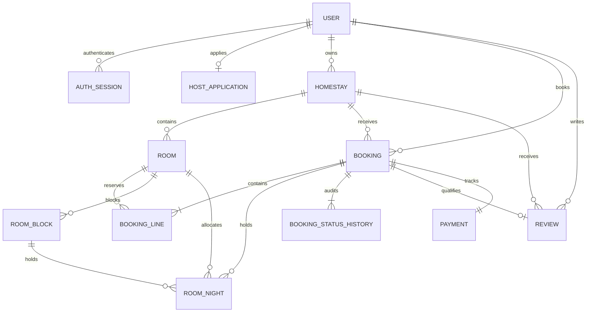

# Schema và quy tắc dữ liệu LuxStay

## Xác minh Phase 8–10

Head vẫn `0005_pay_events`; không thêm bảng/column hoặc sửa revisions đã phát hành trong integration. Các DTO `admin.overview.period` và `host.dashboard.occupancySummary` tổng hợp trên models hiện hữu. Bộ test mới xác minh 105 user/101 homestay không làm KPI bị cắt ở projection 100, date bucket Việt Nam đúng trên SQLite/PostgreSQL. Full suite mới 505 pass/4 skip, chi tiết `PHASE_9_REVIEW.md`.

Frontend chỉ lưu API session/request intent ở sessionStorage; User/Homestay/Room/RoomBlock/Booking/Review/Payment canonical vẫn ở DB. Snapshot booking không đổi khi host sửa giá; unit-night ledger vẫn là ràng buộc tránh oversell. Migration sạch/legacy/backfill/constraint được chạy trên DB test riêng; không migrate/backup/restore DB thật trong lượt này.

## Bổ sung Phase 6–7 (head 0005_pay_events)

- `0004_app_history`: HostApplicationHistory FK application/user, index application_id, snapshot JSON/status/reason/reviewer/time. Backfill chỉ current reviewed application; không thể khôi phục dữ liệu đã bị overwrite trước migration. Decision history append trong transaction approval, giữ User→Application lock order.
- `0005_pay_events`: PaymentEvent FK payment/user, index payment_id, Numeric(14,0) amount/refund_amount và CHECK 0<=refund_amount<=amount, old/new status/source/note/UTC time. Migration tạo legacy_snapshot cho payment hiện có, không tự chuyển status hoặc coi created_at là thời điểm capture đã xác minh.
- Booking create thêm event pending, cancel/reject thêm event khi payment đổi trạng thái; event và nghiệp vụ commit/rollback cùng transaction. Simulation khóa Booking→Payment giống cancel/reject, amount từ booking, không đổi ledger. Unique Payment.booking_id vẫn ngăn payment trùng; state guards và locks chặn paid/refund lặp.
- Không sửa revision 0001–0003. Chỉ sắp import trong migrations/env.py để xử lý lint cũ; không thay logic migration environment. SQLite/PostgreSQL được kiểm migration sạch/upgrade/backfill/metadata bằng database test, không nâng cấp database thật.
- KPI dùng SQL group/sum/count, booking cohort UTC theo ngày Việt Nam; occupancy dùng RoomNight/current inventory, không có inventory history. SIM-* được loại khỏi KPI tiền thu thật và báo ở simulated* riêng. Không có bảng phí/settlement nên platformRevenue=null.

Schema được thiết kế từ source frontend ngày 14/11/2026, không dùng lại danh sách entity của template như một giả định nghiệp vụ.

## Quan hệ và field
- User dùng `display_name` thay vì tạo thêm `full_name`, đúng frontend. Email được chuẩn hóa và unique; hash Argon2id, role, active/token_version kiểm soát trên server. Session chỉ lưu digest jti.
- User có tối đa một hồ sơ HostApplication; đơn bị từ chối được nộp lại trên cùng record, reviewer/time/reason được lưu. Duyệt thay role và vô hiệu hóa token cũ.
- Một host có nhiều homestay, homestay nhiều loại phòng. Amenities/images lưu JSON array để giữ thứ tự và hình dạng source; không cần N-N entity chỉ để chứa tên tiện ích hiện có.
- Booking và Room có quan hệ N-N qua BookingLine, có số lượng và snapshot giá/capacity/name. Đây là yêu cầu thực tế của checkout hiện tại: cùng một đơn chọn nhiều loại phòng.
- Room.inventory là số unit tương đương; RoomNight có UNIQUE(room_id,unit,night), FK booking hoặc block (XOR CHECK), unit dương. Không chiếm ngày checkout.
- RoomBlock là khoảng [start_date,end_date), unit nullable: null giữ mọi unit trong ledger, integer giữ đúng unit. Migration `0003_block_unit` thêm cột và CHECK unit null hoặc 1–100, không đổi ledger/block cũ; mọi row cũ mang null. Tăng inventory mở rộng all-unit blocks, không mở rộng partial blocks; giảm inventory và capacity không được phá reservation đang hoạt động.
- Booking có code unique, FK customer/homestay, unique(customer_id,idempotency_key), request fingerprint, snapshot giá/tên/liên hệ, history và refund_due. Client không được quyết định customer, status hay tổng tiền.
- Review unique theo booking, rating 1–5; POST chỉ nhận completed booking của người đang đăng nhập. Tên và verified lấy server, không lấy tên tự khai.
- Payment chỉ theo dõi nghiệp vụ: mặc định pending/pay_at_property. Không có PAN/CVV; không tự ghi paid/refunded khi chưa có xác nhận cổng thanh toán.
- Bảng `items` template được giữ lại để không mất dữ liệu cũ; catalog thật dùng `homestays`. Không tự đổi chủ sở hữu Item cũ thành host vì sẽ tự cấp quyền.

## Constraint/index
- FK mọi quan hệ; SQLite bật foreign_keys trên mọi connection.
- Index email unique, user role, host_id, city/name/status/created_at, room homestay/status, booking customer/homestay/status/created_at và composite homestay+ngày+status.
- RoomNight index(room_id,night), unique(room_id,unit,night); BookingLine unique(booking_id,room_id), HostApplication unique(user_id), Review unique(booking_id), Payment unique(booking_id/transaction_reference).
- SQLite legacy không thể ADD CHECK vào bảng users đang có FK mà không rebuild: migration dùng trigger kiểm tra role; PostgreSQL có CHECK tương ứng. Dữ liệu users/items cũ giữ nguyên.
- Tiền VND Numeric(14,0), không float trong tính giá. Phí 5% ROUND_HALF_UP; JSON xuất số nguyên an toàn cho JavaScript.
- Timestamp UTC có timezone ở ORM; SQLite được chuyển lại timezone khi đọc. Ngày lưu trú theo lịch Asia/Ho_Chi_Minh, kiểm tra ngày thực tế ở bước nhận/trả phòng.

## Transaction và cạnh tranh
- SQLite development dùng BEGIN IMMEDIATE để serialize transaction; đây không phải lựa chọn dành cho tải production cao.
- PostgreSQL khóa theo thứ tự customer → homestay → room tăng dần khi đặt; host sửa tồn khóa homestay trước room. UNIQUE ở ledger bảo vệ cuối cùng, toàn booking/payment/history rollback nếu một dòng thất bại.
- Cancel/reject giải phóng ledger; snapshot BookingLine không bị đổi khi host sửa giá.
- Idempotency theo customer chống request thanh toán/booking gửi lặp; cùng key khác payload trả 409.
- Phase 5 không đổi schema/revision head 0003_block_unit. Booking.created_at xác định replay 24h và cutoff retention key 30 ngày, unique(customer_id,idempotency_key) vẫn bảo vệ request đồng thời. Maintenance chỉ set idempotency_key=null sau cutoff, không đổi updated_at hoặc xóa Booking/line/history/payment/ledger. Không dùng cleanup để hủy pending hoặc trả tồn; đây là hai nghiệp vụ độc lập. Sau khi key đã purge, cùng key có thể được coi là checkout mới, nên client phải đối soát lịch sử thay vì retry mù quá retention.
- Create refresh customer sau FOR UPDATE rồi kiểm lại active/role/token_version; quote/create khóa homestay rồi room theo ID. Status mutation khóa Booking và refresh identity map, payment chỉ khóa sau Booking khi cancel/reject; không thêm đường khóa ngược room→customer. Host lặp trạng thái trả 409, customer cancel retry idempotent. Pending/confirmed/checked_in giữ ledger; cancelled/rejected giải phóng; completed giữ lịch sử đêm đã qua.

## Seed và giới hạn thống kê
- Seed idempotent chỉ development/test, từ 22 homestay và 48 room đang có; không nhập 550/900 booking dashboard độc lập, không nhập review chưa có completed booking, không nhập credential mock.
- ID user mock có cả số và chuỗi, nên seed tạo ID database và map role/ownership rõ ràng; public homestay giữ itemId, room key lấy itemRoomId thực tế. PostgreSQL sequence được đồng bộ sau seed.
- Homestay chưa có room active không xuất hiện trong kết quả đặt phòng; không tạo giá/tồn phòng giả để đủ số lượng card.
- Dashboard tính revenue theo ngày tạo booking và status, occupancy theo đêm lưu trú × quantity. Mẫu số dùng inventory hiện tại, không giả là lịch sử inventory tuyệt đối. Doanh thu confirmed không đồng nghĩa đã thu tiền.
- Phase 4 đưa JSON amenities (json_each SQLite/json_array_elements_text PostgreSQL), whole-stay availability, capacity, giá và pagination vào SQL; serializer search batch có 5 SELECT cho trang có kết quả. Availability dùng một query ledger cho toàn bộ room. Đây là kiểm tra số query, không phải benchmark tải; cần EXPLAIN/load test và cân nhắc JSONB/GIN hoặc bảng liên kết khi catalog lớn.
